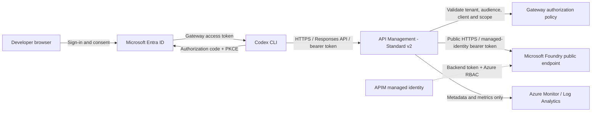

# Azure environment for Codex with Microsoft Foundry

Design and prepare the Azure resources required to use Codex with OpenAI model deployments hosted in a Microsoft Foundry resource (`kind = "AIServices"`), through Azure API Management (APIM).

This document defines the architecture and acceptance criteria. See the [Terraform deployment guide](./DEPLOYMENT.md) for parameters, permissions, validation, and deployment steps. Terraform templates are in [src](./src); the [Codex gateway configuration](../codex_config/README.md) connects the client after deployment. No infrastructure has been deployed by authoring these templates. Claude Code is outside this first phase.

## Goals

- Expose an OpenAI-compatible Responses API through a centrally managed gateway.
- Authenticate Codex users with Microsoft Entra ID using native gateway OAuth.
- Authenticate APIM to the model backend with a managed identity, without API keys.
- Use public HTTPS endpoints without a VNet, with Entra authentication and Azure RBAC protecting backend inference.
- Provision the environment reproducibly with Terraform.

## Proposed architecture

The diagram separates two authentication boundaries:

1. **Codex to APIM:** a user-delegated access token issued for the gateway API.
2. **APIM to Foundry:** a separate access token issued for APIM's managed identity.

APIM must validate the user token **before** replacing the backend `Authorization` header. The user's gateway token must not be forwarded to Foundry.

### APIM tier and networking

**Selected baseline: APIM Standard v2, without VNet integration.** Both APIM and Foundry use public HTTPS endpoints. No VNet, subnets, private endpoints, or private DNS zones are required for this phase.

| Component | Proposed configuration |
| --- | --- |
| APIM ingress | Public HTTPS endpoint protected by Entra token validation; no anonymous model access |
| APIM egress | Public HTTPS; Standard v2 has no dedicated, deterministic outbound public IP |
| Model backend | Foundry resource with public network access enabled from all networks; inference requires Entra authentication and appropriate Azure RBAC |
| DNS | Standard public DNS resolution; no private DNS configuration |
| Region | Choose a region supporting Standard v2, Foundry, and the initial model deployment; prefer colocated resources where availability permits |

Public network access is required for this design; do not disable it on the backend. Standard v2 without VNet integration cannot supply a stable APIM-only outbound IP allowlist. The selected baseline therefore allows all networks at the Foundry network layer, disables key authentication, and restricts inference through Entra and Azure RBAC. It does not configure a regional IP allowlist or trusted-service firewall bypass.

Managed identity secures authentication, not network reachability. This design does **not** enforce network-level gateway isolation: any identity with direct Foundry inference permissions can bypass APIM and its user/model policies. Keep direct inference roles restricted to APIM and approved administrators. A future private-network design requires separate networking review and is outside this phase.

## Required resources and permissions

| Resource or configuration | Purpose |
| --- | --- |
| Resource group | Group environment resources and apply ownership/environment tags |
| APIM Standard v2 instance | Public gateway API, backend configuration, policies, and system-assigned managed identity; no VNet integration |
| Microsoft Foundry resource | `AIServices` account with project management enabled, hosting OpenAI model deployments that support the Responses API |
| Model deployment(s) | Model-name list, Azure-selected default version, and shared deployment type/capacity |
| Entra gateway API application | Define the token audience and delegated access scope |
| Entra public-client application | Enable interactive Codex sign-in with authorization code + PKCE |
| Azure RBAC assignment | Grant APIM's identity `Cognitive Services OpenAI User` on the model resource |
| Log Analytics and diagnostic settings | Capture operational metadata without prompts, source code, or credentials |
| Budget and alerts | Track cost, authentication failures, throttling, backend errors, and latency |

Provisioning requires permissions to create resources and assign Azure roles, plus separate Entra permissions to manage application registrations and consent. Azure subscription Contributor alone does not grant all of these permissions.

Users do not need direct model-resource access. Scope APIM's inference role to the model resource rather than the subscription. Disable local/key authentication on the backend once managed-identity access is verified.

The deployment creates a project-enabled Foundry resource with its own system-assigned managed identity (required for project management), not a standalone Azure OpenAI (`OpenAI`) account. This is separate from APIM's identity used to authenticate inference calls. It does not create a child Foundry project. Codex inference targets Foundry's OpenAI-compatible endpoint, not a project or Agent Service endpoint.

## Authentication design

### 1. Codex to APIM: native gateway OAuth

Use the [Codex gateway OAuth flow](https://learn.chatgpt.com/docs/enterprise/connect-to-a-gateway#choose-an-authentication-method), independently of ChatGPT sign-in.

1. Register a **single-tenant gateway API application** in Entra.
   - Expose a delegated scope, for example `api://<gateway-api-client-id>/Codex.Access`.
   - Configure v2 access tokens and record the expected `aud` claim. For v2 tokens, this is the gateway API's application/client ID, not the Codex public-client ID or the full scope URI.
2. Register a separate **public-client application** for Codex.
   - Use authorization code flow with PKCE; do not create or distribute a client secret.
   - Register the loopback redirect URI supported by the tested Codex version. For a fixed port of `43127`, the Codex documentation specifies `http://127.0.0.1:43127/callback`.
   - Add the gateway's delegated permission and obtain consent according to tenant policy.
3. Supply the following non-secret settings for the [Codex configuration](../codex_config/README.md):

   | Setting | Value |
   | --- | --- |
   | Authorization URL | `https://login.microsoftonline.com/<tenant-id>/oauth2/v2.0/authorize` |
   | Token URL | `https://login.microsoftonline.com/<tenant-id>/oauth2/v2.0/token` |
   | Client ID | Codex public-client application's client ID |
   | Scopes | Gateway delegated scope and `offline_access` for refresh-token issuance |
   | Redirect port | Fixed port matching the registered callback, if required |
   | Token delivery | `Authorization: Bearer <gateway-access-token>` |

4. Configure APIM to validate the tenant, signature, expiry, gateway audience, allowed client application ID, and `Codex.Access` scope in `scp`.
5. Define which users or groups may use the gateway and enforce that restriction through Entra application assignment and/or explicit gateway authorization. A scope grant alone is not a user allowlist.

Use a Codex release that supports native gateway OAuth and the intended token-delivery method. The current gateway documentation specifies CLI **0.166.0 or later** for default bearer delivery in gateway-only mode. Pin and test a release rather than relying on an unspecified latest version.

For gateway-only authentication, the Codex configuration uses `requires_openai_auth = false` and must not also configure an API key or static bearer token. Native gateway OAuth needs a browser and reachable loopback callback; it has no device-code fallback. WSL, containers, and remote SSH sessions require callback connectivity testing.

> The Microsoft Learn direct-Azure Codex guide still describes an API-key setup and lists a direct Entra limitation. This design instead uses Codex's documented **gateway OAuth** support and APIM's independent managed identity. Validate this combination end to end before treating it as supported for this repository.

### 2. APIM to Foundry: managed identity

1. Enable APIM's system-assigned managed identity.
2. Assign it `Cognitive Services OpenAI User` on the selected model resource.
3. After validating the incoming gateway token, use `authentication-managed-identity` with resource `https://cognitiveservices.azure.com` and `ignore-error="false"`.
4. Replace the backend `Authorization` header with the resulting managed-identity bearer token, and remove any client-supplied `api-key` header.
5. Verify public HTTPS connectivity and role propagation. The templates disable local/key authentication from creation; keep backend public network access enabled.

The two tokens have different audiences and are not interchangeable. APIM validates incoming OAuth tokens; configuring an OAuth authorization server in APIM's developer portal alone does **not** enforce API authentication.

## APIM API and policy configuration

Use one gateway API with a stable base URL, for example:

- Codex base URL: `https://<apim-name>.azure-api.net/openai/v1`
- Client operation: `POST /openai/v1/responses`
- Backend operation: `POST https://<resource-name>.services.ai.azure.com/openai/v1/responses`

Use the endpoint hostname actually provided by the deployed resource. Preserve the `/openai/v1` path exactly once when combining the APIM API suffix, backend URL, and operation path. The v1 API does not require an `api-version` query parameter.

| Area | Required configuration |
| --- | --- |
| API surface | Start with `POST /responses` relative to the gateway base URL; add only operations required by tested Codex features |
| Protocol | Use the Responses API (`wire_api = "responses"` in the Codex configuration), not a Chat Completions translation |
| Subscription keys | Set subscription-required to false for this API; Entra authorization is mandatory instead |
| Inbound authorization | Run `validate-azure-ad-token` with the tenant, audience, allowed client IDs, and required delegated scope |
| Model authorization | Allow only approved deployment names in the request's `model` field; reject unknown names explicitly |
| Routing | Set the approved backend and preserve the Responses request body and query parameters |
| Backend authentication | Acquire the managed-identity token and overwrite `Authorization` only after user authorization succeeds |
| Streaming | Preserve server-sent events and use `forward-request` with `buffer-response="false"`; avoid body transformations or logging that buffer streamed responses |
| Limits | Apply per-user request limits keyed by validated tenant/user identity; verify token-limit policy support for the chosen Responses models before using token-based limits |
| Reliability | Set explicit timeouts and test long responses; do not blindly retry generation requests or retry after streaming starts |
| Errors | Preserve meaningful backend errors and `429`/`Retry-After` behavior; return explicit failures for authentication, authorization, and routing errors |
| Diagnostics | Record correlation ID, approved deployment, status, duration, and available usage metadata; redact tokens and disable prompt/response-body logging |

Review inherited global, product, and API policies so they cannot bypass these checks or re-enable body logging. If model validation reads the JSON body, preserve it for forwarding.

Do not assume importing an Azure OpenAI API into APIM exposes every Responses operation needed by Codex. Validate the actual generated API and policies.

## Model deployment plan

The following names are the requested candidates, **not a verified availability list**:

| Candidate |
| --- |
| GPT-6.1-Sol |
| GPT-6.1-Terra |
| GPT-6-Astra |
| GPT-6-Luna |
| GPT-5.6-Sol |
| GPT-5.6-Terra |
| GPT-5.6-Luna |

Before provisioning each candidate, record:

- Model name as accepted by Azure after lowercasing and trimming, and the default version Azure assigns; arbitrary display-name aliases are not resolved.
- Subscription access, supported region, Responses API support, and Codex compatibility.
- Deployment type, its data-processing geography, and applicable residency requirements. A regional resource does not make a Global deployment region-bound.
- Required capacity and available quota for that model and deployment type.
- Deployment name exposed through the gateway, intended use, and estimated cost.

Set the `models` list in the Terraform parameter file, for example `["GPT-6-Sol", "GPT-6-Luna"]`. Terraform creates one deployment per normalized name (`gpt-6-sol`, `gpt-6-luna`) and uses those same names for the APIM allowlist and Codex handoff. No separate model ID or version is required; Azure selects its default version at creation, with subsequent automatic upgrades disabled.

Start with **one validated deployment** to prove authentication, networking, and streaming. Add the remaining models after that baseline passes. Codex's `model` value must match the normalized Azure deployment name.

If custom model metadata is needed, distribute a local Codex model catalog. Native gateway OAuth alone does not enable remote model-catalog discovery.

## Deployment

Follow the [Terraform deployment guide](./DEPLOYMENT.md) to configure parameters, review permissions and costs, validate the templates, and provision a new resource group. The implementation uses public Standard v2 APIM and a Microsoft Foundry resource without VNet integration.

## Acceptance checklist

- [ ] Initial model, version, region, deployment type, quota, and cost are verified.
- [ ] Terraform plan creates a project-enabled `AIServices` Foundry resource and public Standard v2 APIM, with no VNet, subnet, private endpoint, or private DNS resources.
- [ ] Codex browser sign-in, MFA where required, and token refresh work with the pinned client.
- [ ] Missing, expired, wrong-tenant, or wrong-audience tokens are rejected.
- [ ] Unapproved clients/users and tokens without the required scope are rejected.
- [ ] Unknown or unapproved model deployment names are rejected.
- [ ] APIM reaches Foundry's OpenAI-compatible endpoint over public HTTPS and authenticates using its managed identity.
- [ ] Foundry allows all networks as agreed; unauthenticated inference is denied, and the lack of network-level gateway isolation is understood.
- [ ] Backend API-key authentication is disabled and ordinary gateway users have no direct inference role assignments.
- [ ] A real Codex task completes through APIM, including streamed output, a tool call, and a follow-up turn.
- [ ] Long-running requests, throttling, and backend failures produce usable behavior without duplicate generation.
- [ ] Logs contain no access tokens, API keys, prompts, source code, or model response bodies.
- [ ] Budget and operational alerts are configured; all non-secret client handoff values are recorded.

## References

- [Codex: connect to a gateway and choose authentication](https://learn.chatgpt.com/docs/enterprise/connect-to-a-gateway#choose-an-authentication-method)
- [Codex with Azure OpenAI in Microsoft Foundry Models](https://learn.microsoft.com/azure/foundry/openai/how-to/codex)
- [Azure OpenAI Responses API](https://learn.microsoft.com/azure/foundry/openai/how-to/responses)
- [APIM IP addresses and backend allowlists](https://learn.microsoft.com/azure/api-management/api-management-howto-ip-addresses)
- [APIM v2 tiers and networking capabilities](https://learn.microsoft.com/azure/api-management/v2-service-tiers-overview)
- [Authenticate and authorize LLM APIs through APIM](https://learn.microsoft.com/azure/api-management/api-management-authenticate-authorize-azure-openai)
- [Validate Microsoft Entra tokens in APIM](https://learn.microsoft.com/azure/api-management/validate-azure-ad-token-policy)